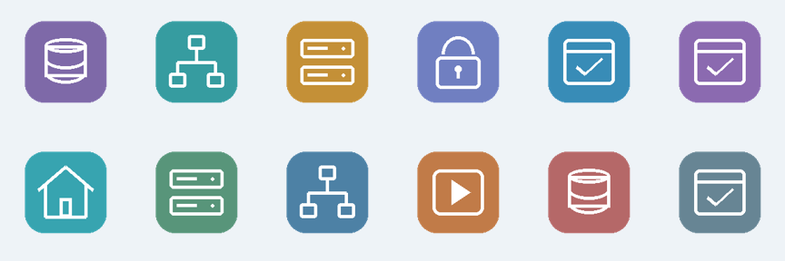

# Atlas Homelab Essentials

A small original icon pack for Atlas application cards and dependency maps. Twelve graphics cover databases, proxies, storage, identity, containers, VMs, home automation, backups, networking, media, caches and generic applications.

## Install

Open **Marketplace → Icon packs → Homelab essentials**, download and review the package, then confirm the repository. Installation imports images only; no executable code or credentials are involved.

Installed icons appear in **Edit application → Application icon**. Automatic matching uses names, image names or roles. Explicit selections override matching. Removing a pack restores default graphics without deleting applications.

## Pack format

`atlas-icons.json` declares `schemaVersion: 1` and an `icons` list. Each icon declares a unique slug `id`, a `name`, a relative PNG/JPEG/WebP `file`, its `sha256`, and optional `match` names. Use static images no larger than 1024 × 1024, 150 KB each, 4 MB total, up to 200 icons. Atlas converts images to local 128px PNG previews; SVG/HTML and install hooks are not accepted.

## License

MIT. These are original generic illustrations, not manufacturer logos. Copyright (c) 2026 42bios.
